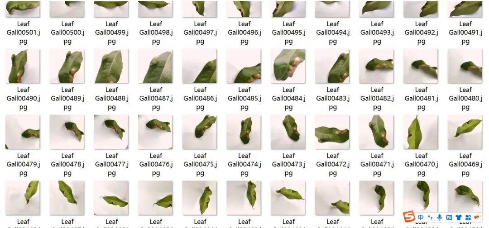
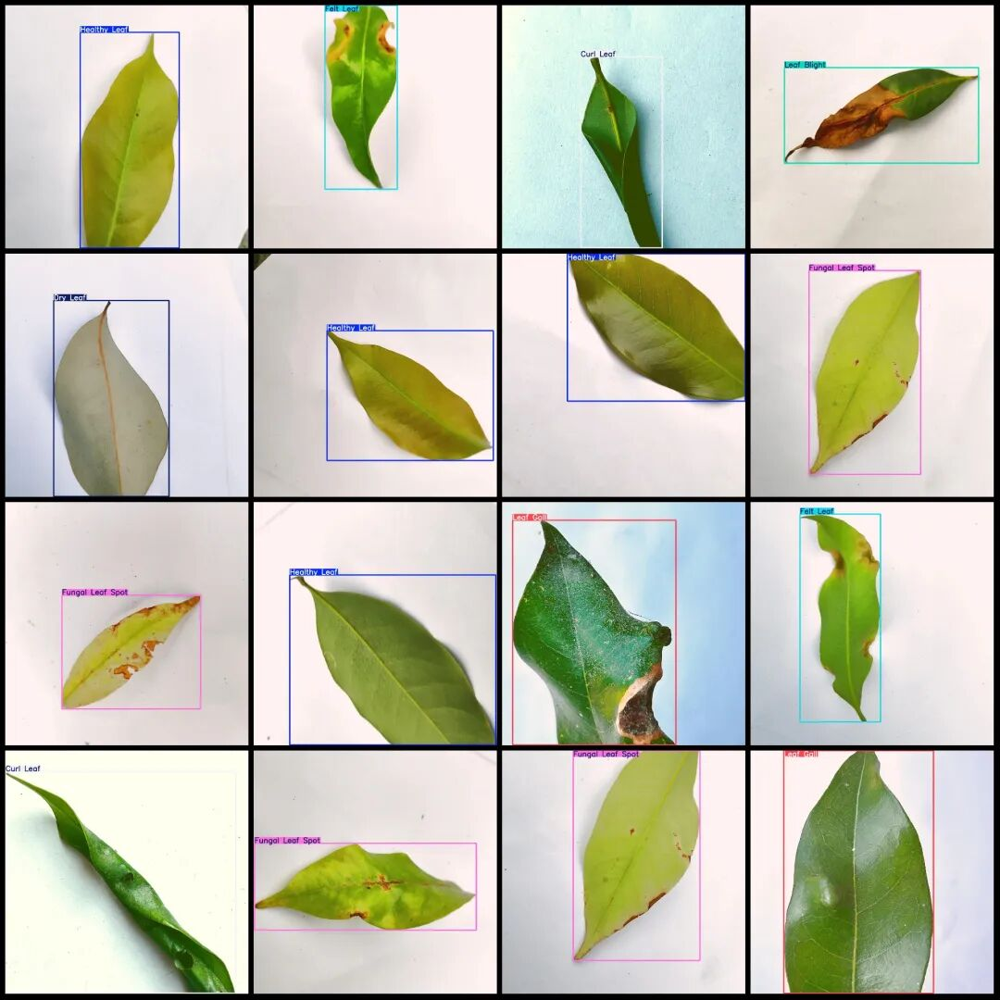

# Litchi Leaf Disease Detection Dataset in VOC+YOLO format with 3767 images across 10 categories all featuring single leaves

Dataset format: Pascal VOC format + YOLO format (txt file without split path, only containing jpg images and corresponding VOC format xml files and yolo format txt files)

Number of images (number of jpg files): 3767

Number of annotations (number of xml files): 3767

Number of annotations (number of txt files): 3767

Label category count: 10

Label category names (Note that the order of categories in the YOLO format does not correspond to this, but is based on the classes.txt file in the labels folder): ["Anthrax Leaf", "Bituminous Leaf", "Curl Leaf", "Deficiency Leaf", "Dry Leaf", "Felt Leaf", "Fungal Leaf Spot", "Healthy Leaf", "Leaf Blight", "Leaf Gall"]

Number of boxes labeled in each category:

Anthrax Leaf Frames = 148

Bituminous Leaf Frame Count = 138

Curl Leaf Frame Count = 181

Deficiency Leaf Frame Count = 125

Dry Leaf Frame Count = 396

Felt Leaf Frame Count = 382

Fungal Leaf Spot frame count = 574

Healthy Leaf frame count = 643

Leaf Blight frame count = 591

Leaf Gall Frame Count = 623

Total frame count: 3801

Using labelImg:

Annotation rules: Draw a rectangle around the category.

Important Notice: No

Special : This dataset does not guarantee the accuracy or precision of the trained models or weight files. The dataset is provided with accurate and reasonable annotations only.

Image Preview:

Annotation example:

## Payment

Here is a pay link on Stripe ( https://buy.stripe.com/3cs8yP7sY87d0vu9AB ). Please contact me lonlonago@foxmail.com after funding $89, and I will send you a complete data files , thank you!

